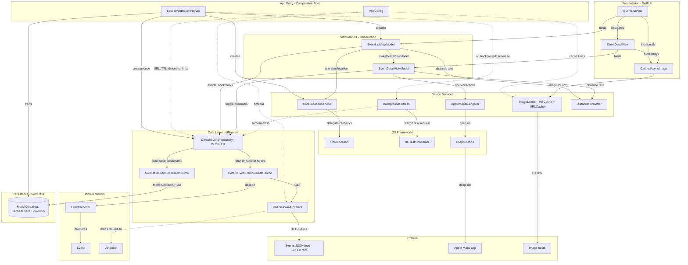
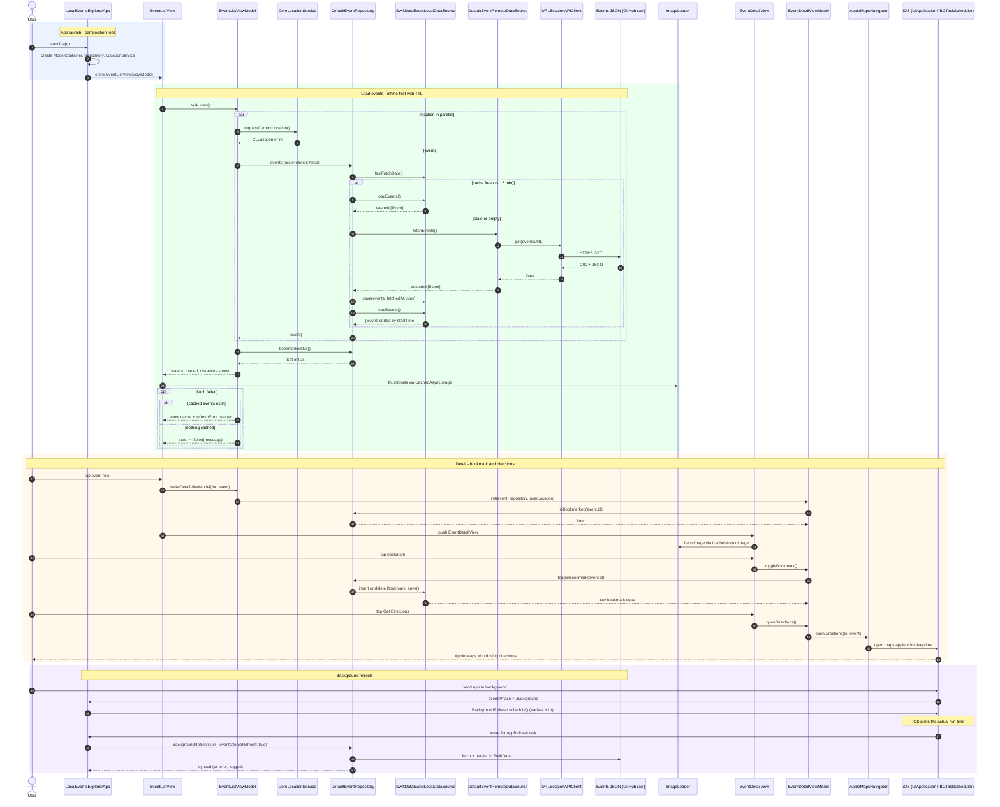

# LocalEventsExplorer_AE - App Architecture

LocalEventsExplorer_AE is a SwiftUI iOS app that shows nearby events from a remote JSON feed, with an offline-first SwiftData cache, bookmarks, location-based distances, and background refresh.

## All-App Architecture Diagram

A single end-to-end view of every component: app entry, SwiftUI views, view models, domain models, data layer, persistence, device services, iOS frameworks, and external services. Solid arrows are runtime call/data flow; dotted arrows are configuration or cross-cutting influence.

<!-- mermaid-checked: no \n, no em-dash/en-dash, no {} in labels, subgraphs are id["label"], arrows are -->|"label"|, all subgraphs closed by end, ids unique -->

### Technology Stack Summary

| Layer | Technology | Version | Purpose |
|---|---|---|---|
| Presentation | SwiftUI | iOS 17+ | Declarative UI, NavigationStack, pull-to-refresh |
| State | Observation (`@Observable`) | iOS 17+ | View model state driving the views |
| Data access | SwiftData (`@Model`, `ModelContext`) | iOS 17+ | Offline cache (`CachedEvent`) and bookmarks (`Bookmark`) |
| Networking | URLSession (async/await) | Foundation | JSON GET with timeout and `APIError` mapping |
| Location | CoreLocation | - | One-shot "When In Use" location for distances |
| Background | BackgroundTasks (`BGAppRefreshTask`) | - | Periodic event sync while backgrounded |
| Images | NSCache + URLCache | - | Two-level (memory + disk) image caching |
| Logging | os.Logger | - | Structured logs under subsystem `LocalEventsExplorer_AE` |
| Tests | Swift Testing (`@Test`) | - | 32 unit tests for repository, data sources, view models, formatters |

### Key Architectural Decisions

- **Offline-first repository with TTL**: `DefaultEventRepository` serves SwiftData-cached events when fresh (< 15 min), otherwise fetches remotely, persists, and re-reads from the cache - the local store is the single source of truth.
- **Protocol-based dependency injection from a composition root**: all dependencies (`EventRepository`, `EventRemoteDataSource`, `EventLocalDataSource`, `WebAPIClientService`, `LocationService`, `MapsNavigator`, `ImageLoading`) are protocols wired once in `LocalEventsExplorerApp.init`, enabling the test doubles in `LocalEventsExplorer_AETests`.
- **Graceful degradation on failure**: refresh errors on a loaded list surface as a non-blocking banner; when offline with a prior sync, the cached list is shown with the banner instead of a failure screen.

## All-App Sequence Diagram

One end-to-end trace of the entire app lifecycle: launch, offline-first event loading, detail with bookmark and directions, and background refresh.

<!-- mermaid-checked: no \n, no em-dash/en-dash, no {} in labels, participants are plain ids, all alt/par/opt/rect blocks closed by end -->

